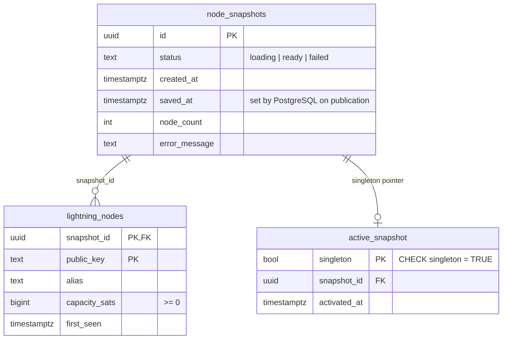

# Lightning Nodes Service

A production-quality Rust backend for the **Superhuman Back-end Coding Challenge**:
it imports Lightning Network node connectivity rankings from [mempool.space],
persists them in PostgreSQL as **immutable versioned snapshots**, and serves the
latest successfully published snapshot over HTTP.

[mempool.space]: https://mempool.space/api/v1/lightning/nodes/rankings/connectivity

## Overview

- **Import**: a background scheduler fetches `GET /api/v1/lightning/nodes/rankings/connectivity` every 10 minutes (configurable), validates the complete payload, and persists it as a new snapshot.
- **Publish**: publication is an atomic PostgreSQL transaction: verify count → mark `ready` → assign `saved_at` (PostgreSQL server time) → flip the `active_snapshot` pointer.
- **Serve**: `GET /nodes` returns the nodes of the active snapshot only. Failed imports never touch the active snapshot.
- **History**: successful snapshots are retained per a configurable retention policy; failed attempts are recorded for observability.

## Architecture

Modular monolith, **package by feature** (no global `controllers/`/`services/` layers):

```
src/
├── app/            bootstrap, router, configuration, shared state
├── shared/         error taxonomy, database pools, telemetry
└── features/
    ├── nodes/
    │   ├── domain/           entities + pure transformations (integer-only math)
    │   ├── commands/         write use case + repository trait
    │   ├── queries/          read use case + reader trait
    │   ├── infrastructure/   mempool client, Postgres reader/writer
    │   └── http/             handlers, DTOs, routes
    ├── synchronization/      scheduler, status, history cleanup
    └── health/               liveness/readiness probes
```

- **Read/write separation** (logical CQRS): the read path is a single indexed query; the write path is batched append-only inserts plus a short publication transaction.
- HTTP handlers are thin; business behavior lives in feature use cases; domain logic is independent of Axum and SQLx.
- No Redis, no Kafka, no microservices.

```mermaid
flowchart LR
    subgraph external
        MP[mempool.space API]
    end
    subgraph process["nodes-svc (Rust / Axum)"]
        SCH[Scheduler] --> SYNC[Sync use case]
        SYNC -->|fetch| MP
        SYNC --> W[Postgres writer]
        H[HTTP /nodes] --> R[Postgres reader]
        ST[/sync/status] --> STATUS[SyncStatus]
        SYNC --> STATUS
    end
    subgraph db[(PostgreSQL)]
        NS[node_snapshots] --- LN[lightning_nodes]
        NS --- AS[active_snapshot singleton]
    end
    W --> NS
    R --> AS
```

## Technology stack

| Component | Choice |
|---|---|
| Language | Rust 1.94, edition 2024 |
| HTTP | Axum 0.8 |
| Runtime | Tokio |
| DB | PostgreSQL 17, SQLx 0.8 |
| Provider client | Reqwest (rustls, timeouts) |
| Config | TOML + env vars |
| Errors / logs | thiserror, tracing |
| Tooling | mise, just |
| Tests | Testcontainers (real Postgres), wiremock |

## Running locally

```bash
mise trust && mise install     # pins Rust, just, sqlx-cli
cp .env.example .env           # adjust DATABASE_URL if needed
mise exec -- just db-up        # starts development PostgreSQL
mise exec -- just db-migrate   # optional; the app also migrates on startup
mise exec -- just dev          # runs the application on :3000
```

All commands: `mise exec -- just --list`.

## Running with Docker

```bash
docker compose -f docker/compose.yaml up --build -d    # PostgreSQL + application
curl http://localhost:3000/nodes
```

Logs: `docker compose -f docker/compose.yaml logs -f app`. Stop without deleting data: `docker compose -f docker/compose.yaml down`.
Reset the database (destructive): `just db-reset`.

**Migrations** run during application startup before the server binds. This is
safe because sqlx records applied migrations in `_sqlx_migrations` and takes a
PostgreSQL advisory lock, so concurrent starters cannot race; the app also
waits for the `postgres` health check before starting.

### Verifying with curl

```bash
# List nodes (extended mode: includes saved_at)
curl -i http://localhost:3000/nodes

# Liveness — always 200 while the process runs
curl -i http://localhost:3000/health/live

# Readiness — 200 when the database is reachable
curl -i http://localhost:3000/health/ready

# Synchronization status — last success/failure and active snapshot id
curl -i http://localhost:3000/sync/status

# Pretty-print the nodes payload
curl -s http://localhost:3000/nodes | jq .
```

## Configuration

Precedence: **environment variables > `config/default.toml` > built-in defaults**.

| Key (TOML) | Env var | Default | Meaning |
|---|---|---|---|
| `database.url` | `DATABASE_URL` | — (required) | PostgreSQL connection string |
| `server.host` | `SERVER_HOST` | `0.0.0.0` | Bind host |
| `server.port` | `SERVER_PORT` | `3000` | Bind port |
| `database.read_pool_max_connections` | — | `10` | Read pool size |
| `database.write_pool_max_connections` | — | `2` | Write pool size |
| `database.acquire_timeout_seconds` | — | `5` | Pool acquire timeout |
| `mempool.base_url` | `MEMPOOL_BASE_URL` | `https://mempool.space` | Provider base URL |
| `mempool.timeout_seconds` | `MEMPOOL_TIMEOUT_SECONDS` | `10` | Request + connect timeout |
| `synchronization.interval_seconds` | `SYNC_INTERVAL_SECONDS` | `600` | Sync period |
| `synchronization.batch_size` | `SYNC_BATCH_SIZE` | `500` | Insert batch size (≤ 13107) |
| `synchronization.sync_on_startup` | `SYNC_ON_STARTUP` | `true` | Import once at startup |
| `synchronization.reject_empty_response` | `REJECT_EMPTY_RESPONSE` | `true` | Treat empty payload as failure |
| `history.retention_days` | `HISTORY_RETENTION_DAYS` | `30` | Remove inactive snapshots older than this |
| `history.minimum_successful_snapshots` | `HISTORY_MINIMUM_SUCCESSFUL_SNAPSHOTS` | `3` | Always keep this many ready snapshots |
| `api.include_saved_at` | `API_INCLUDE_SAVED_AT` | `true` | Extend `/nodes` with `saved_at` |
| — | `RUST_LOG` | `info` | tracing filter |

Invalid values (zero intervals, zero pools, oversized batches, bad booleans)
are rejected at startup with actionable errors.

## API reference

### `GET /nodes`

Nodes of the latest successfully published snapshot. `200 OK` with `[]` before
the first successful import.

```json
[
  {
    "public_key": "03864ef025...",
    "alias": "ACINQ",
    "capacity": "360.10516297",
    "first_seen": "2018-04-05T15:13:42Z",
    "saved_at": "2026-11-17T13:00:00Z"
  }
]
```

| Field | Behavior |
|---|---|
| `public_key` | Preserved exactly |
| `alias` | Preserved exactly (including empty aliases) |
| `capacity` | Satoshi→BTC via integer arithmetic, exactly 8 decimals |
| `first_seen` | Unix seconds → RFC 3339 UTC, second precision, `Z` |
| `saved_at` | Publication timestamp persisted by PostgreSQL; shared by all nodes of the snapshot; stable between requests |

**Compatibility mode**: set `API_INCLUDE_SAVED_AT=false` to omit `saved_at`,
restoring the original challenge contract of exactly four fields. Both modes
are tested.

### `GET /health/live` — always `200` while the process runs.
### `GET /health/ready` — `200` when the database is reachable. A failed synchronization does **not** fail readiness while the last valid snapshot is servable; staleness is exposed via `/sync/status`.
### `GET /sync/status`

```json
{
  "state": "idle",
  "last_success": { "at": "...", "snapshot_id": "...", "node_count": 2942 },
  "last_failure": { "at": "...", "category": "provider_timeout", "message": "..." },
  "last_snapshot_count": 2942,
  "active_snapshot_id": "..."
}
```

Executable requests live in [`requests/lightning-nodes.http`](requests/lightning-nodes.http).

## Database design



Lifecycle: `loading` → `ready` (successful, atomic publication) or
`loading` → `failed` (recorded, active snapshot untouched). Nodes cascade on
snapshot deletion, so retention cleanup is one bounded statement.

**Failure during sync**: a crash mid-import leaves a `loading` snapshot that
can never become active (publication requires verifying the row count inside
the transaction); a later cleanup reaps stale snapshots. Multiple instances are
serialized with `pg_advisory_xact_lock` at publication, and in-process overlap
is prevented by a scheduler mutex.

**Why snapshots instead of UPSERT/full-replace**: historical versions are
preserved, publication is a single-row flip (no rewrite of live rows), readers
never block, and rollback is trivial — a failed import simply never publishes.

## Performance

Read path (`GET /nodes`) is one query over the covering index
`lightning_nodes (snapshot_id, public_key) INCLUDE (alias, capacity_sats,
first_seen)`: index-only scan, no N+1, deterministic order. Run
`EXPLAIN (ANALYZE, BUFFERS) <query>` on your dataset to verify; the query text
is in `src/features/nodes/infrastructure/postgres_reader.rs`.

Write path uses `QueryBuilder` batched multi-row inserts (batch size
`SYNC_BATCH_SIZE`, clamped to respect the 65535-parameter limit), followed by a
short publication transaction. `COPY FROM STDIN` was considered but not
implemented: the real mempool ranking (~3–4k nodes) imports in well under a
second with batched inserts, so the added complexity is not justified without
measurements.

Benchmark: `just up` then `just benchmark` (wraps
[`scripts/benchmark.sh`](scripts/benchmark.sh), which reports p50/p95/p99 of
the **full HTTP endpoint** under concurrency). Dataset sizes 100/1k/10k/100k
are benchmarks *targets* for evaluating scaling behavior, not assumptions
about the real response. No latency numbers are claimed without running the
script in your environment.

## Testing

```bash
just test               # unit tests (no network, no Docker)
just test-integration   # integration tests (requires Docker for Testcontainers)
just test-all
just ci                 # fmt-check + clippy -D warnings + check + unit + release
```

- **Unit tests**: monetary conversions (incl. the spec examples), timestamp
  conversions (epoch zero, pre-epoch, out-of-range), domain validation,
  configuration precedence and validation, sync use case with fakes (success,
  provider failure, persistence failure, empty payload, duplicates).
- **Integration tests** (15 scenarios): initial import, provider
  timeout/500/invalid JSON, database failure, snapshot replacement, history
  retention, atomic publication under concurrent reads, `saved_at` stability,
  compatibility mode, cleanup policy, startup with provider down, reads never
  calling the provider, parallel request consistency, migration/constraint
  validation.

## Trade-offs

- **PostgreSQL only**: one stateful dependency covers persistence, atomic
  publication (transactions + advisory locks) and history; Redis/Kafka would
  add operational surface without solving a measured problem.
- **Modular monolith, not microservices**: one deployable, one database;
  features are isolated in code, not over the network.
- **Snapshot versioning over in-place updates**: immutability gives history,
  atomic flips and cheap rollback for the cost of some storage.
- **Batched inserts over COPY**: simpler, fast enough for the real payload;
  revisit only with benchmark evidence.
- **No in-memory cache in v1**: the indexed single query is already the
  bottleneck-free path; a cache would add invalidation complexity. It can be
  added behind `ListNodes` if benchmarks justify it.

## Original challenge questions

- **What was the reason for your focus?** Correctness of the snapshot lifecycle
  (never serving mixed or partial data) and read latency; those are the parts
  users observe.
- **What problems were you trying to solve?** Atomic publication, failure
  isolation between import and serving, precise monetary/time formatting, and
  reproducible operations (mise/just/CI).
- **How long did this take?** _To be filled by the developer._
- **What trade-offs did you make?** See the Trade-offs section; the most
  notable is skipping COPY and caching without measurements.
- **What would you do differently with more time?** Add Prometheus metrics
  exposition and a `COPY`-based importer benchmark for 100k+ datasets.
- **What is the weakest part?** The benchmark script is curl-based, not a
  proper load tool (no warmup phase or ramp profiles).
- **What additional information would be useful?** Expected production load
  and number of replicas, to size pools and decide on distributed scheduler
  fencing beyond advisory locks.

## License

MIT
