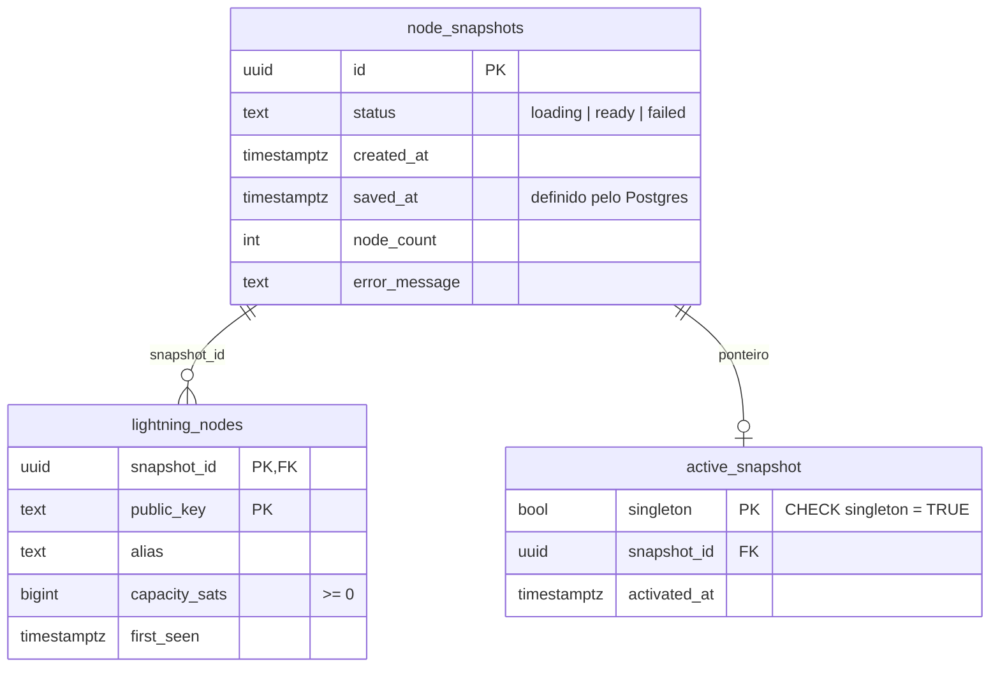

# Nodes service

Importa o ranking de conectividade de nós da Lightning Network da [API do mempool.space], persiste os dados no PostgreSQL em **snapshots versionados e imutáveis** e disponibiliza o snapshot publicado mais recente por HTTP.

[API do mempool.space]: https://mempool.space/api/v1/lightning/nodes/rankings/connectivity

## Visão geral

- **Importação**: um scheduler em segundo plano consulta `GET /api/v1/lightning/nodes/rankings/connectivity` a cada 10 minutos (configurável), valida todo o conteúdo e persiste um novo snapshot.
- **Publicação**: uma transação atômica no PostgreSQL verifica a contagem, marca o snapshot como `ready`, define `saved_at` com o horário do servidor PostgreSQL e atualiza o ponteiro `active_snapshot`.
- **Exposição**: `GET /nodes` retorna somente os nós do snapshot ativo. Uma importação com falha não altera o snapshot ativo.
- **Histórico**: snapshots bem-sucedidos são mantidos conforme uma política de retenção configurável; tentativas com falha são registradas para observabilidade.

## Arquitetura

Monólito modular organizado por funcionalidade (**Package by Feature**), sem camadas globais `controllers/` ou `services/` que misturem funcionalidades:

```text
src/
├── app/            inicialização, roteador, configuração e estado compartilhado
├── shared/         erros, pools de banco de dados e telemetria
└── features/
    ├── nodes/
    │   ├── domain/           entidades e transformações puras (aritmética inteira)
    │   ├── commands/         caso de uso de escrita e interface do repositório
    │   ├── queries/          caso de uso de leitura e interface do leitor
    │   ├── infrastructure/   cliente mempool.space e adaptadores PostgreSQL
    │   └── http/             handlers, DTOs e rotas
    ├── synchronization/      agendador, status e limpeza do histórico
    └── health/               verificações de disponibilidade
```


### Diagrama do projeto

```mermaid
flowchart LR
    subgraph externos[Serviços externos]
        MP[mempool.space API]
    end
    subgraph app[nodes-svc — Rust / Axum]
        SCH[Agendador] --> SYNC[Caso de uso de sincronização]
        SYNC -->|busca dados| MP
        SYNC --> W[Escritor PostgreSQL]
        H[HTTP /nodes] --> R[Leitor PostgreSQL]
        ST[/sync/status] --> STATUS[Status da sincronização]
        SYNC --> STATUS
    end
    subgraph db[PostgreSQL]
        NS[node_snapshots] --- LN[lightning_nodes]
        NS --- AS[active_snapshot singleton]
    end
    W --> NS
    R --> AS
```

Os diagramas estão em [`docs/arquitetura.md`](docs/arquitetura.md).

## Tecnologias

| Componente | Tecnologia |
|---|---|
| Linguagem | Rust 1.94 |
| HTTP | Axum 0.8 |
| Banco de dados | PostgreSQL 17, SQLx 0.8 |
| Configuração | TOML + variáveis de ambiente |
| Ferramentas | mise, just |

## Execução local

```bash
mise trust && mise install     # instala as ferramentas nas versões fixadas
cp .env.example .env           # ajuste DATABASE_URL se necessário
mise exec -- just db-up        # inicia o PostgreSQL de desenvolvimento
mise exec -- just db-migrate   # opcional; a aplicação também migra ao iniciar
mise exec -- just dev          # executa a aplicação na porta 3000
```

Para listar os comandos: `mise exec -- just --list`.

## Execução com Podman

```bash
podman-compose -p nodes-svc -f docker/docker-compose.yaml up --build -d  # PostgreSQL + aplicação
curl http://localhost:3000/nodes
```

**As migrações** são executadas pela aplicação antes de o servidor começar a aceitar conexões. O SQLx registra as migrações aplicadas em `_sqlx_migrations` e usa um advisory lock do PostgreSQL, evitando concorrência entre inicializações; a aplicação também aguarda a verificação de saúde do serviço PostgreSQL.

> `just db-reset` é destrutivo: remove o volume de dados local e solicita confirmação explícita. Os comandos comuns de parada preservam os volumes.

### Verificação com curl

```bash
# Listar nós (modo estendido: inclui saved_at)
curl -i http://localhost:3000/nodes

# Liveness — retorna 200 enquanto o processo estiver em execução
curl -i http://localhost:3000/health/live

# Readiness — retorna 200 quando o banco estiver acessível
curl -i http://localhost:3000/health/ready

# Estado da sincronização — último sucesso/falha e ID do snapshot ativo
curl -i http://localhost:3000/sync/status

# Exibir a resposta formatada
curl -s http://localhost:3000/nodes | jq .
```

## Configuração
| Chave (TOML) | Variável de ambiente | Padrão | Descrição |
|---|---|---:|---|
| `database.url` | `DATABASE_URL` | — (obrigatório) | URL de conexão do PostgreSQL |
| `server.host` | `SERVER_HOST` | `0.0.0.0` | Endereço de escuta |
| `server.port` | `SERVER_PORT` | `3000` | Porta HTTP |
| `database.read_pool_max_connections` | — | `10` | Tamanho do pool de leitura |
| `database.write_pool_max_connections` | — | `2` | Tamanho do pool de escrita |
| `database.acquire_timeout` | `DB_ACQUIRE_TIMEOUT` | `5s` | Timeout para obter conexão do pool |
| `mempool.base_url` | `MEMPOOL_BASE_URL` | `https://mempool.space` | URL base do provedor |
| `mempool.timeout` | `MEMPOOL_TIMEOUT` | `10s` | Timeout de conexão e requisição |
| `synchronization.interval` | `SYNC_INTERVAL` | `600s` | Intervalo entre sincronizações |
| `synchronization.batch_size` | `SYNC_BATCH_SIZE` | `500` | Tamanho do lote de inserção (máximo 13.107) |
| `synchronization.sync_on_startup` | `SYNC_ON_STARTUP` | `true` | Executa importação na inicialização |
| `synchronization.reject_empty_response` | `REJECT_EMPTY_RESPONSE` | `true` | Trata resposta vazia como falha |
| `history.retention_days` | `HISTORY_RETENTION_DAYS` | `30` | Remove snapshots inativos expirados |
| `history.minimum_successful_snapshots` | `HISTORY_MINIMUM_SUCCESSFUL_SNAPSHOTS` | `3` | Quantidade mínima de snapshots `ready` preservados |
| `api.include_saved_at` | `API_INCLUDE_SAVED_AT` | `true` | Inclui `saved_at` em `/nodes` |
| — | `RUST_LOG` | `info` | Filtro do tracing |

Valores inválidos (intervalo zero, pools vazios, lotes acima do limite ou booleanos inválidos) são rejeitados na inicialização com mensagens de erro explicativas.

## Referência da API

### `GET /nodes`

Retorna uma página dos nós do snapshot publicado mais recentemente, mantendo a
resposta como array JSON para preservar o contrato existente. Antes da primeira
importação bem-sucedida, retorna `200 OK` com `[]`.

Parâmetros de consulta:

| Parâmetro | Padrão | Limite | Descrição |
|---|---:|---:|---|
| `page` | `1` | maior que zero | Número da página, começando em 1 |
| `per_page` | `20` | de 1 a 100 | Quantidade de nós por página |

Exemplo: `GET /nodes?page=2&per_page=25`. A ordenação é estável por `public_key`.
Além do array de nós, a resposta inclui os cabeçalhos `X-Total-Count`,
`X-Page`, `X-Per-Page` e `X-Total-Pages`. Uma página além do fim retorna
`200 OK`, `[]` e os metadados totais. Parâmetros fora dos limites retornam
`400 Bad Request`.

```json
[
  {
    "public_key": "03864ef025...",
    "alias": "ACINQ",
    "capacity": "360.10516297",
    "first_seen": "2018-04-05T15:13:42Z",
    "saved_at": "2026-11-17T13:00:00Z"
  }
]
```

| Campo | Comportamento |
|---|---|
| `public_key` | Preservado exatamente como recebido |
| `alias` | Preservado exatamente, inclusive quando vazio |
| `capacity` | Conversão de satoshis para BTC com aritmética inteira e exatamente 8 casas decimais |
| `first_seen` | Segundos Unix convertidos para RFC 3339 UTC, precisão de segundos e sufixo `Z` |
| `saved_at` | Horário de publicação persistido pelo PostgreSQL; igual para todos os nós do snapshot e estável entre requisições |

**Compatibilidade com o desafio original**: defina `API_INCLUDE_SAVED_AT=false` para omitir `saved_at` e retornar exatamente os quatro campos originalmente exigidos. Os dois modos são cobertos por testes.

### `GET /health/live`

Verificação de liveness. Retorna `200` enquanto o processo estiver em execução.

### `GET /health/ready`

Verificação de readiness. Retorna `200` quando o banco de dados está acessível. Uma falha de sincronização não torna o serviço indisponível enquanto o último snapshot válido puder ser servido; a defasagem pode ser observada em `/sync/status`.

### `GET /sync/status`

```json
{
  "state": "idle",
  "last_success": { "at": "...", "snapshot_id": "...", "node_count": 2942 },
  "last_failure": { "at": "...", "category": "provider_timeout", "message": "..." },
  "last_snapshot_count": 2942,
  "active_snapshot_id": "..."
}
```

Requisições prontas para execução estão em [`requests/lightning-nodes.http`](requests/lightning-nodes.http).

## Modelo de dados



Ciclo de vida: `loading` → `ready` (importação bem-sucedida, publicação atômica) ou `loading` → `failed` (falha registrada, snapshot ativo preservado). Os nós são removidos em cascata quando um snapshot é excluído, permitindo que a limpeza seja feita em uma operação limitada.

**Falha durante a sincronização**: uma queda do processo durante a importação pode deixar um snapshot `loading`, que não pode ser ativado sem a verificação da contagem de registros na transação de publicação. A limpeza posterior remove snapshots expirados. Várias instâncias são serializadas no momento da publicação por `pg_advisory_xact_lock`; um mutex do agendador impede sobreposição dentro do processo.

**Por que snapshots em vez de UPSERT/substituição completa**: versões históricas são preservadas, a publicação altera um único ponteiro, leitores não ficam bloqueados e a recuperação é simples — uma importação malsucedida nunca é publicada — ao custo de armazenamento adicional.

## Testes

```bash
just test               # testes unitários (sem rede ou Podman)
just test-integration   # testes de integração (requer Podman ou runtime compatível com Docker)
just test-all
just ci                 # fmt-check + clippy -D warnings + check + todos os testes + release
```

## Perguntas referentes ao desafio

- **Qual foi o foco e por quê?** A criação da máquina de estado dos snapshots e a entrega de um dado mesmo que "frio" caso a API externa apresente latência ou falha.
- **Que problemas a solução busca resolver?** Isolamento entre atualizações (criação do snapshots) e uma entrega rápida mesmo sem um cache.
- **Quanto tempo foi dedicado ao projeto?** Cerca de 12 horas
- **Quais tradeoffs foram feitos?** Não utilização de cache a fim de simplificar a atualização dos dados. Além disso, a política de retenção de dados antigos foi configurada por 30 dias, a fim de manter o tamanho do banco estável 
- **O que seria feito com mais tempo?** Adicionar métricas customizadas e a criação dos dashboards em alguma ferramenta.
- **Qual é a parte mais fraca?** O benchmark usa curl, em vez de uma ferramenta dedicada de carga, e não inclui aquecimento nem perfis de ramp-up.
- **Que informação adicional seria útil?** A carga esperada em produção e a quantidade de réplicas, além de outros endpoints que poderiam ser usados caso algum apresentasse alguma falha.
