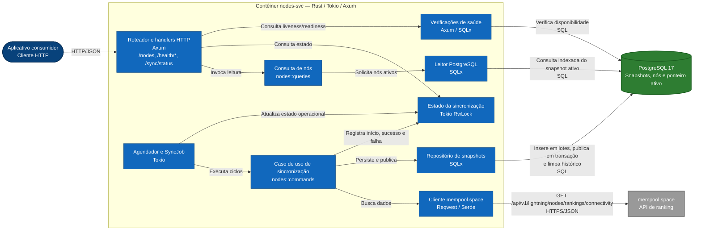

# Arquitetura

Este documento descreve a arquitetura implementada pelo `nodes-svc`. 

## Contexto do sistema

O serviço importa periodicamente o ranking de conectividade da Lightning
Network, mantém snapshots publicados no PostgreSQL e expõe os dados por uma API
HTTP. Aplicativos consumidores consultam os nós; operadores executam e
monitoram o serviço. O mempool.space é a fonte externa dos dados.

### Componentes da aplicação

O diagrama detalha os principais componentes dentro do projeto em Rust. Os
módulos seguem a organização por funcionalidade (`nodes`, `synchronization` e
`health`); os adaptadores HTTP, HTTP externo e PostgreSQL ficam nas fronteiras.

### Fluxos principais

#### Leitura

1. O handler `GET /nodes` invoca a consulta de nós.
2. O leitor executa uma consulta parametrizada no PostgreSQL, vinculada ao
   snapshot ativo, selecionando somente os campos necessários, contando os
   resultados e retornando o intervalo pedido com ordenação por `public_key`.
3. A resposta mantém `public_key` e `alias`, converte satoshis em BTC por
   aritmética inteira, formata `first_seen` em UTC e, no modo estendido, inclui
   o `saved_at` persistido pelo banco.

#### Sincronização e publicação

1. O agendador executa um ciclo na inicialização (se habilitado) e depois no
   intervalo configurado, sem bloquear a disponibilidade HTTP.
2. O cliente Reqwest busca o ranking e desserializa os campos necessários.
3. O caso de uso valida o payload completo, incluindo chaves duplicadas,
   capacidade e timestamps, antes de criar um snapshot.
4. Os nós são escritos em lotes em um novo snapshot `loading`.
5. Uma transação curta verifica a contagem, marca o snapshot `ready`, define
   `saved_at` usando o horário do PostgreSQL e troca o ponteiro ativo.
6. Se a importação ou publicação falhar, o snapshot anterior continua ativo; a
   falha é registrada e o ciclo seguinte tentará novamente.
7. A limpeza do histórico é best-effort, preserva o snapshot ativo e respeita
   a quantidade mínima configurada de snapshots bem-sucedidos.

### Persistência e limites de consistência

- `node_snapshots` registra estado, contagem e timestamps de cada importação.
- `lightning_nodes` armazena os dados de cada versão, com chave composta
  `(snapshot_id, public_key)` e exclusão em cascata quando um snapshot é removido.
- `active_snapshot` aponta para a versão publicada. A atualização desse
  ponteiro e a marcação de publicação ocorrem na mesma transação.
- As linhas de um snapshot publicado não são atualizadas. Leituras concorrentes
  observam uma versão completa, nunca uma mistura de snapshots.
- A exclusão de histórico é executada fora do caminho HTTP e não remove a
  versão ativa.

## Referências de implementação

- Inicialização e composição: `src/app/bootstrap.rs`
- Rotas e estado da aplicação: `src/app/router.rs` e `src/app/state.rs`
- Domínio e transformações: `src/features/nodes/domain/`
- Importação e publicação: `src/features/nodes/commands/` e
  `src/features/nodes/infrastructure/`
- Agendamento, status e retenção: `src/features/synchronization/`
- Migrações PostgreSQL: `migrations/`
- Requisitos detalhados do projeto: `../prompt`
- Enunciado original: [`desafio.pdf`](desafio.pdf)
